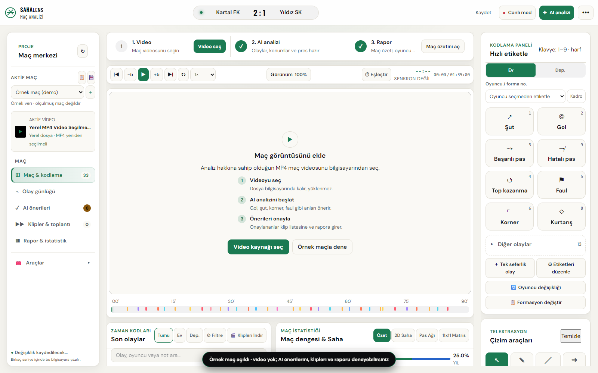
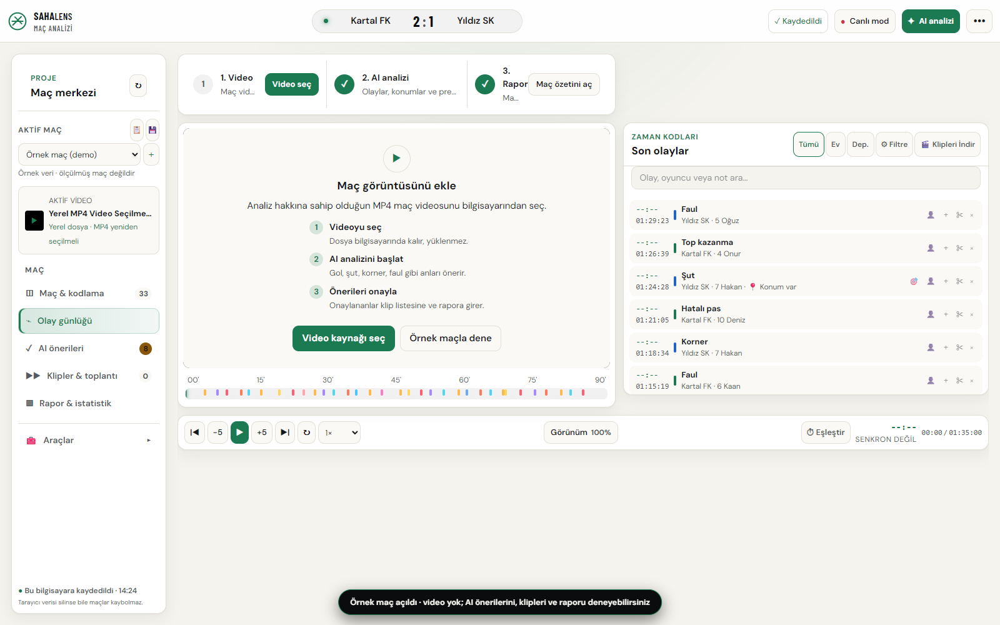
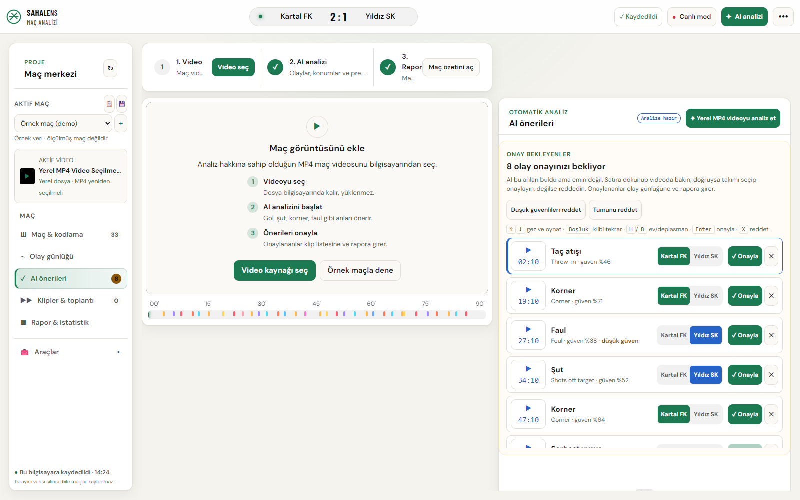
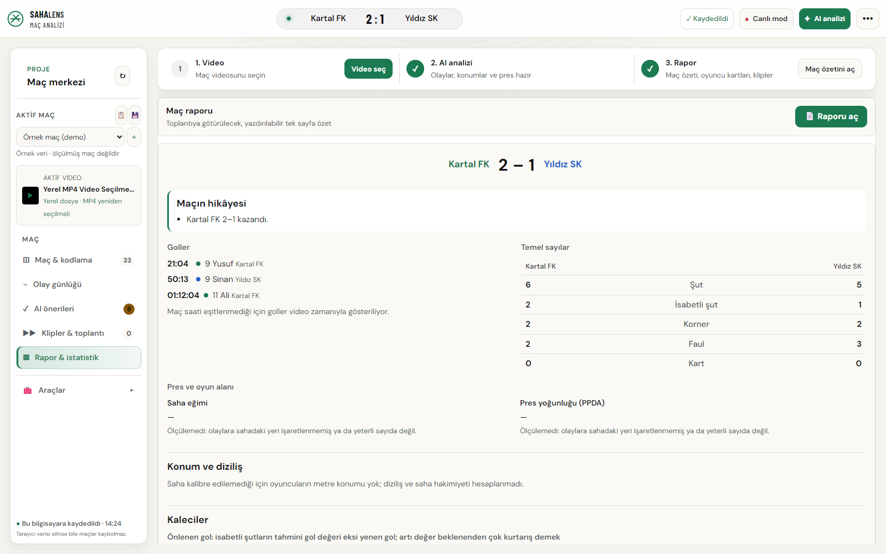
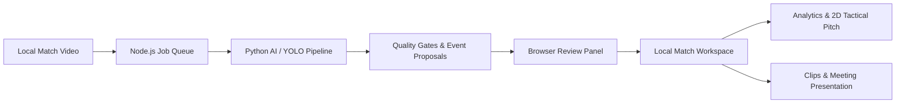

# SahaLens — Product & Architecture Showcase ⚽📹

**English** | [Türkçe](README.tr.md)

**Local-first football video analysis and tactical meeting studio.**

SahaLens is a computer-vision powered video analysis platform built for amateur and semi-professional football clubs to extract automated event tags, tactical replay clips, and actionable match reports from local recordings.

Core pipeline: **Local Video ➔ AI Event Proposals ➔ Coach Review & Tagging ➔ Tactical Clips ➔ Team Meeting**.

> ℹ️ **About This Showcase:**  
> This repository is a **product showcase and technical portfolio**. The underlying application source code, proprietary model weights, match videos, and tactical databases are maintained in a private repository. This repository provides architectural specifications, system design, and UI screenshots generated with sanitized sample match data.

---

## 📸 UI Walkthrough & Core Screens

Screenshots reflect a running instance using built-in synthetic sample match data.

### 1. Match Studio
Timeline controls, custom video player, freehand tactical telestration, and live event queue:

---

### 2. Event Log
Timestamped chronological event stream, player tags, and action filters:

---

### 3. AI Event Review Queue
Coach-in-the-loop review interface for validating, adjusting, or rejecting computer-vision proposed passes, shots, and fouls:

---

### 4. Reports & Match Statistics
Shot-location expected goals (xG) maps, passing networks, team momentum, and individual player performance summaries:

---

## 🏗️ System Architecture

---

## 🎯 Key Module Capabilities

| Domain | Implementation Scope |
| --- | --- |
| **Match Workspace** | Match metadata, rosters, timestamped event streams, local persistence, and backups |
| **Broadcast Analysis** | Temporal action localization, scoreboard/clock OCR, and verification queue |
| **Computer Vision** | Player/ball detection, spatial tracking, and 2D pitch homography calibration |
| **Tactical Review** | Interactive 2D pitch, passing networks, canvas telestration, and set-piece planner |
| **Analytics Engine** | Shot-location based xG, narrative generation, player and opposition scouting reports |
| **Team Meeting** | Instant clip generation, full-screen presentation mode, and printable PDF summaries |
| **Voice Notes** | Local audio transcription powered by faster-whisper for speech-to-text coaching logs |

---

## 💻 Tech Stack

| Layer | Technologies & Purpose |
| --- | --- |
| **Frontend** | JavaScript (ES6+), HTML5, Canvas API, CSS3; custom 2D pitch, interactive telestration |
| **Local Server** | Node.js HTTP runtime, file-based workspace storage, and background analysis worker queue |
| **Vision & AI** | Python, PyTorch, Ultralytics YOLO, OpenCV, NumPy, SciPy |
| **Action Recognition** | ResNet feature extraction with temporal convolutional / Transformer architectures |
| **Audio Transcription** | faster-whisper for local speech-to-text |
| **Quality & QA** | ESLint, Node test runner, Python unittest, Playwright, axe-core accessibility |

---

## 📚 Technical Documentation
- [System Architecture & Design Decisions](docs/ARCHITECTURE.md)
- [Product Roadmap & Engineering Phases](docs/ROADMAP.md)
- [Visual Asset Notices & License Scope](NOTICE.md)

---

## 🔒 Confidentiality & Privacy Notice
All core video inference is executed locally (on-device). Proprietary model checkpoints, commercial training sets, and club tactical archives are not published in this showcase.
