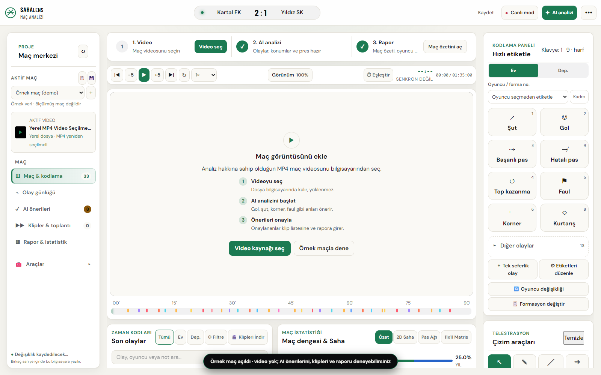
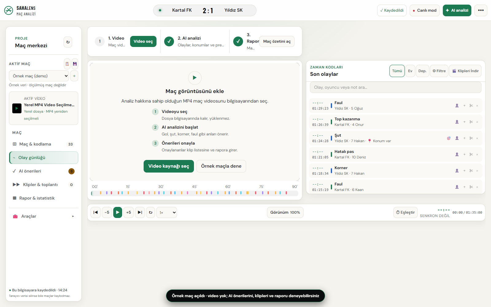
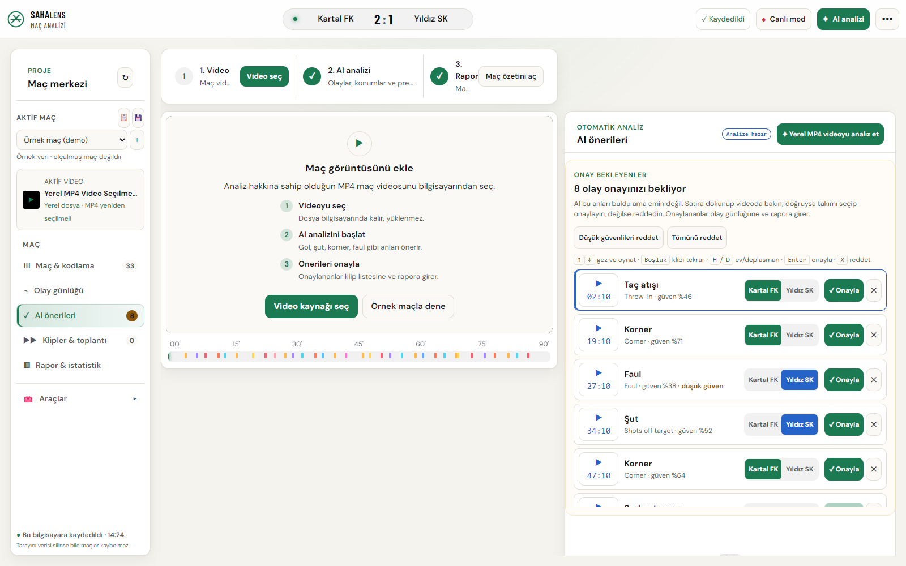
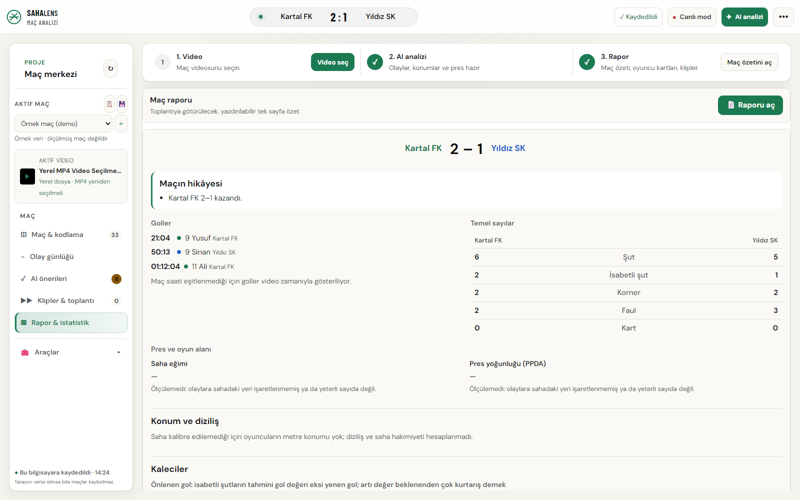
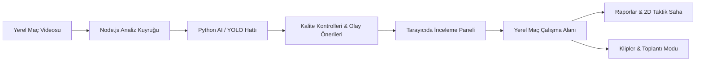

# SahaLens — Ürün ve Mimari Vitrini ⚽📹

[English](README.md) | **Türkçe**

**Yerel çalışan futbol video analiz ve taktik toplantı stüdyosu.**

SahaLens, amatör ve yarı profesyonel takımların maç görüntülerinden bilgisayarlı görü ve yapay zekâ ile olay önerileri, taktik klipler ve anlaşılır raporlar üretmesini amaçlayan bir video analiz platformudur.

Ana iş akışı: **Yerel Video ➔ AI Olay Önerileri ➔ İnceleme & Etiketleme ➔ Taktik Klipler ➔ Takım Toplantısı**.

> ℹ️ **Bu Vitrin Hakkında:**  
> Bu depo **ürün tanıtımı ve teknik portföy** içindir. Uygulama kaynak kodu, model ağırlıkları, maç videoları ve kullanıcı verileri burada yayımlanmaz. Kaynak kod özel bir GitHub deposunda geliştirilir. Bu depo bir kurulum paketi veya açık kaynak yazılım dağıtımı değildir.

---

## 📸 Arayüzden Görüntüler ve Modüller

Görüntüler çalışan uygulamadan, kurmaca takımlar içeren yerleşik **örnek maç** kullanılarak alınmıştır.

### 1. Maç Stüdyosu (Match Studio)
Zaman çizgisi, video oynatıcı, taktik çizim araçları ve anlık olay listesi:

---

### 2. Olay Günlüğü (Event Log)
Zaman damgalı olay akışı, oyuncu etiketleri ve aksiyon filtreleme:

---

### 3. AI Önerilerinin İncelenmesi (Review Queue)
Modelin tespit ettiği şut, pas ve faul önerilerini antrenörün tek tıkla onayladığı veya düzelttiği inceleme kuyruğu:

---

### 4. Maç Raporu ve İstatistikler (Analytics & Stats)
Şut konumuna dayalı xG haritası, pas ağları, takım verimliliği ve oyuncu performans özetleri:

---

## 🏗️ Sistem Mimarisi

---

## 🎯 Geliştirilen Temel Modüller

| Alan | Uygulamadaki Karşılığı |
| --- | --- |
| **Maç Çalışma Alanı** | Maçlar, kadrolar, zaman damgalı olaylar, yerel kayıt ve yedekler |
| **Yayın Analizi** | Zamansal olay modeli, skor ve maç saati OCR, inceleme kuyruğu |
| **Görüntü İşleme** | Oyuncu/top tespiti, takip (tracking) ve 2D saha kalibrasyonu araştırmaları |
| **Taktik İnceleme** | 2D saha, pas ağı, saha üstü serbest çizimler, duran top planları |
| **Raporlama** | Şut konumuna dayalı xG, maç hikâyesi, oyuncu ve rakip analiz raporları |
| **Toplantı & Klipler** | Olaylardan otomatik klip listesi, sunum görünümü ve yazdırılabilir rapor çıktıları |
| **Sesli Notlar** | faster-whisper ile yerel sesli konuşma çözümleme (antreman notları) |

---

## 💻 Kullanılan Teknolojiler

| Katman | Teknolojiler ve Amaç |
| --- | --- |
| **Arayüz (Frontend)** | JavaScript (ES6+), HTML5, Canvas API, CSS3; interaktif taktik saha ve video üzeri çizimler |
| **Yerel Sunucu** | Node.js HTTP sunucusu, dosya tabanlı çalışma alanı ve analiz iş kuyruğu |
| **Yapay Zekâ & Görüntü** | Python, PyTorch, Ultralytics YOLO, OpenCV, NumPy, SciPy |
| **Yayın Olay Modeli** | ResNet öznitelik çıkarımı, zamansal konvolüsyon / Transformer mimarisi |
| **Sesli Notlar** | faster-whisper ile yerel konuşma tanıma |
| **Kalite ve Testler** | ESLint, Node test runner, Python unittest, Playwright, axe-core erişilebilirlik |

---

## 📚 Dokümantasyon
- [Mimari ve Tasarım Kararları](docs/ARCHITECTURE.md)
- [Geliştirme Yol Haritası](docs/ROADMAP.md)
- [Görsellerin Kaynağı ve Kullanım Koşulları](NOTICE.md)

---

## 🔒 Gizlilik Bildirimi
Temel video işleme tamamen yereldir (on-device). Model ağırlıkları ve özel antrenör veritabanı bu depoda yer almaz.
