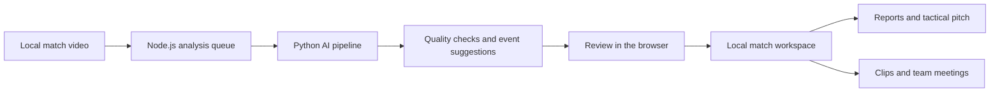

# Architecture

SahaLens combines a browser interface with a server running on the same computer. The server delegates analysis jobs to Python processes.

## Design decisions

- **Local video:** Core analysis does not require a cloud upload.
- **Storage awareness:** Existing video files are used where possible; large datasets and weights are separate from source code.
- **Traceability:** Results retain timestamps, generation methods and experimental status.
- **Quality gates:** Unreliable tracking or calibration should not be presented as trustworthy physical measurements.
- **Modularity:** Frontend features, server functions and Python analysis components are organized separately.

## Verification

Calculation and persistence functions have unit tests. Browser tests cover interface interactions, with automated axe-core accessibility checks. Model performance requires separate evaluation against labeled data: passing a UI test does not establish correct event detection.

## Repository separation

The private repository holds source code, tests and engineering documentation. Large models, datasets, local workspaces and secrets are stored separately. The public repository contains showcase documentation and fictional-demo screenshots, without the private repository's Git history.
