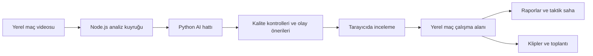

# Mimari

SahaLens, tarayıcı arayüzü ve aynı bilgisayarda çalışan sunucudan oluşur. Analiz gerektiren işler Python süreçlerine aktarılır.

## Temel kararlar

- **Yerel video:** Video işleme için bir bulut yüklemesi gerekmez.
- **Disk duyarlılığı:** Mümkün olduğunda mevcut video dosyası kullanılır; veri setleri ve ağırlıklar kaynak koddan ayrı tutulur.
- **Kaynak izlenebilirliği:** Olayın zamanı, üretim yöntemi ve deneysel durumu sonuçla birlikte taşınır.
- **Kalite kapıları:** Takip veya saha kalibrasyonu yetersizken fiziksel istatistikler güvenilir ölçüm gibi sunulmamalıdır.
- **Modülerleşme:** Arayüz özellikleri, sunucu işlevleri ve Python analiz bileşenleri ayrı modüllerde geliştirilir.

## Test yaklaşımı

Hesaplama ve kayıt işlevleri birim testleriyle; arayüz etkileşimleri tarayıcı testleriyle kontrol edilir. Erişilebilirlik için otomatik axe-core denetimleri vardır. AI model başarısı ayrı, etiketli değerlendirme gerektirir: bir arayüz testinin geçmesi modelin doğru olay bulduğunu kanıtlamaz.

## Depoların ayrımı

Özel depo çalışan kaynak kodunu, testleri ve geliştirme belgelerini barındırır. Büyük modeller, veri setleri, yerel çalışma alanları ve sırlar ayrıca saklanır; private depo da sır veya sınırsız dosya yedeği değildir. Public tanıtım deposu yalnızca bu belgeler ve örnek veriyle çekilmiş ekran görüntülerini içerir. Özel deponun Git geçmişi public depoya taşınmaz.
